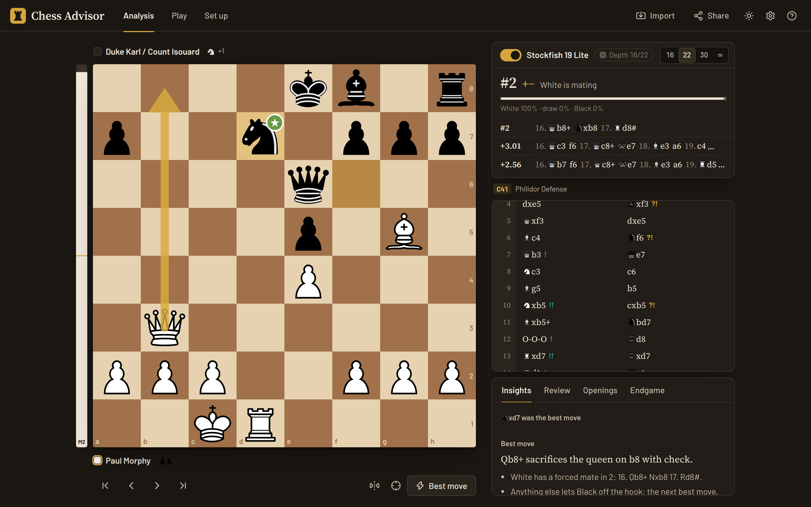
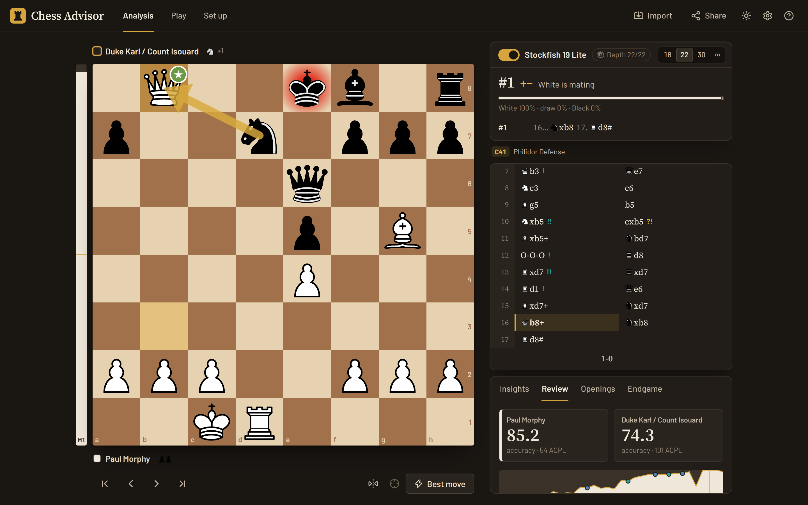
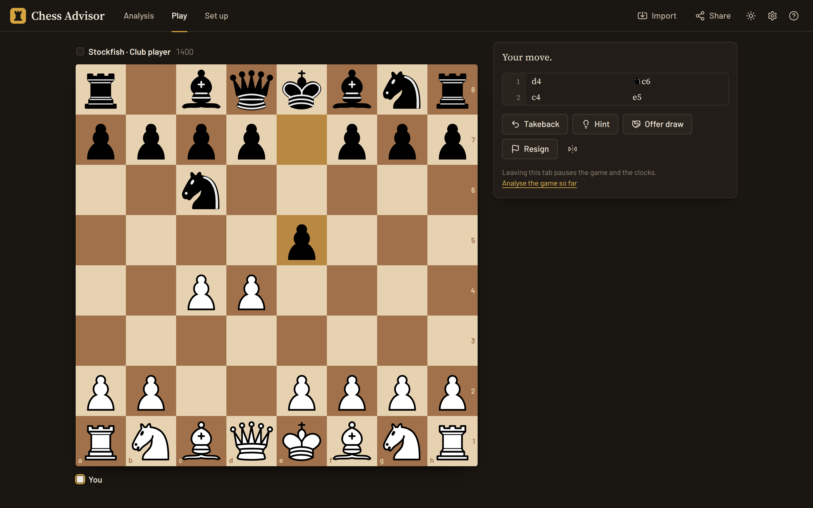
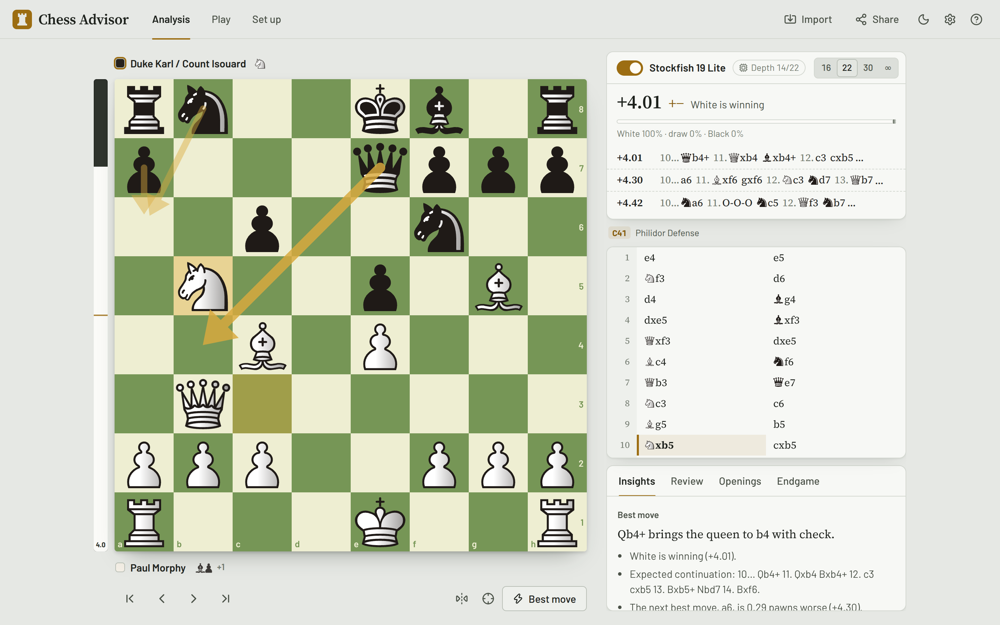

<div align="center">


# Chess Advisor

**Free, private chess analysis in your browser, powered by Stockfish 19.**

[](https://github.com/YasWish/chess-advisor/actions/workflows/ci.yml)
[](LICENSE)
[](https://stockfishchess.org)

[**Open Chess Advisor**](https://yaswish.github.io/chess-advisor/) · [Report a bug](https://github.com/YasWish/chess-advisor/issues/new/choose) · [Changelog](CHANGELOG.md)



</div>

## Overview

Chess Advisor is a chess analysis board that runs entirely in your browser. Set up or import
any position and Stockfish 19, the strongest chess engine in the world, tells you the best
moves, how good the position is, and what your opponent is threatening. It explains the best
move in plain English, reviews whole games move by move with an accuracy score for each
player, lets you practise the positions where you went wrong, and gives you a sparring
partner from beginner to full strength.

There is nothing to install and no account to create. The engine is compiled to WebAssembly
and runs on your own device, so analysis keeps working offline and your games never leave
your computer unless you choose to share them.

## Features

**Live analysis.** Stockfish searches the position on the board as you move through a game,
showing up to five candidate lines with their evaluations, an evaluation bar, and the
engine's win, draw and loss probabilities. Arrows mark the best moves on the board, and a
threat mode shows what the opponent would play if it were their turn. Positions that the
Lichess cloud database has already analysed deeply appear instantly.

**Explanations.** Beside the numbers, the Insights tab says in words what the best move does:
whether it wins material, forks, pins, skewers, uncovers a discovered attack, saves a piece
that was under attack, or sacrifices material for a forced mate. It also points out loose
pieces, pins, weak back ranks and passed pawns on the verge of promoting, for both sides.

**Game review.** Stockfish grades every move of a game, from brilliant to blunder, marks the
key moments on an interactive evaluation graph, and computes each player's accuracy and
average centipawn loss. Moves that look like mistakes are double-checked with a deeper
search before they are called one, so a good move is not condemned by a noisy evaluation.



**Practise your mistakes.** After a review, the board takes you back to each of your mistakes
and asks you to find a better move. Any move that is nearly as good as the engine's choice
counts, and you can reveal the answer when you are stuck.

**Play Stockfish.** Ten levels, from a beginner who hangs pieces to full strength, with or
without a chess clock. Levels 4 to 9 use Stockfish's own calibrated Elo limiter. You can
premove, take moves back, ask for a hint or offer a draw, and hand the finished game straight
to the reviewer.



**Openings and endgames.** The name of the opening is shown as you play, recognised by
position so transpositions are caught, and the Openings tab lists the named continuations
from the current position. With seven or fewer pieces on the board, the Endgame tab consults
the Syzygy tablebases for perfect play: the result with best play and the verdict for every
legal move.

**Import, export and share.** Paste a PGN, a FEN or a Lichess game link, open a .pgn file, or
pick from a player's recent games on Lichess or Chess.com. Games keep their variations,
comments and clock times. Export PGN with or without engine evaluations and move grades, copy
a link to a position or a game, or open the position on Lichess.

**Board editor.** Set up any position by dragging pieces or placing them with a click, choose
the side to move and castling rights, and have it checked for legality before analysing it
or playing it out against the engine.

**Made to be used every day.** Dark and light themes, six board colour schemes, six piece
sets, figurine notation, synthesised move sounds, full keyboard control, and a layout that
works on phones. Your settings and your last game are saved on your device, and the app can
be installed and used offline.



## Getting started

The simplest way is to open **<https://yaswish.github.io/chess-advisor/>**. It needs a
current browser with WebAssembly support, such as a recent version of Chrome, Edge, Firefox
or Safari, on a computer or a phone.

To run it on your own machine you need [Node.js](https://nodejs.org) 22 or newer:

```sh
git clone https://github.com/YasWish/chess-advisor.git
cd chess-advisor
npm ci
npm run dev
```

and open the address it prints. `npm run build` produces a static site in `dist/` that can be
served by any web server, from any path.

### Keyboard shortcuts

| Keys                                                        | Action                      |
| ----------------------------------------------------------- | --------------------------- |
| <kbd>←</kbd> <kbd>→</kbd>                                   | Previous and next move      |
| <kbd>↑</kbd> <kbd>↓</kbd> or <kbd>Home</kbd> <kbd>End</kbd> | Start and end of the line   |
| <kbd>Space</kbd>                                            | Play the engine's best move |
| <kbd>L</kbd>                                                | Turn the engine on or off   |
| <kbd>X</kbd>                                                | Show the opponent's threat  |
| <kbd>F</kbd>                                                | Flip the board              |
| <kbd>R</kbd>                                                | Review the game             |
| <kbd>I</kbd> / <kbd>S</kbd>                                 | Import / share and export   |
| <kbd>?</kbd>                                                | Help                        |

## How it works

### The engine

Chess Advisor ships the official Stockfish 19 source compiled to WebAssembly by the
[stockfish.js](https://github.com/nmrugg/stockfish.js) project, in its single-threaded "lite"
build: a 1.8 MB download that needs no special server headers, which is what allows the app
to run on GitHub Pages or any static host. It runs in a Web Worker so the page never freezes,
and it talks to the app over the standard UCI protocol. A small scheduler makes sure only one
search runs at a time and always waits for a stopped search to report back before the next
one starts, so a result can never be attributed to the wrong position. The provenance and
checksums of the engine files are recorded in [`public/engine/`](public/engine/README.md).

When cloud evaluations are enabled, the app first asks the Lichess cloud database whether the
position has already been analysed, which is often the case in the opening, and falls back to
the local engine otherwise.

### Grading moves and measuring accuracy

A move is judged by how much it changes the mover's chances of winning, not by raw
centipawns, because giving away a pawn matters far more in a level position than in one that
is already won or lost. Evaluations are converted to winning chances with the formula Lichess
derived from millions of rated games, and a move that throws away at least 5, 10 or 15
percentage points is an inaccuracy, a mistake or a blunder respectively, the same thresholds
Lichess uses.

Engine evaluations at review depth are not perfectly stable: the search after a move can find
a defence that the search before it missed, and a sound move then looks like a blunder. So
every move that looks like a mistake or a blunder is verified with a second, deeper search that compares
the played move and the engine's choice side by side within one search, and the grade comes
from that comparison.

On top of the classic grades, a move is **best** when it matches the engine's choice,
**great** when it is the only move that keeps the advantage (obvious recaptures excepted),
**brilliant** when it is a sound piece sacrifice that is also the best move and the position
was not already completely won, and a **missed win** when a player fails to punish the
opponent's mistake. Opening moves from the Lichess opening database count as **book**.

Accuracy is computed the way Lichess computes it: each move gets an accuracy from the winning
chances before and after it, and a player's game accuracy is the average of a
volatility-weighted mean and the harmonic mean of those numbers, which rewards consistency
and punishes blunders.

## Privacy

Chess Advisor has no server, no analytics and no cookies. Your settings and your last game
are kept in your browser's local storage. The app only talks to other sites in these cases,
all of which you can avoid:

- **Cloud evaluations** send the position (its FEN) to `lichess.org`. They are on by default
  and can be switched off in Settings.
- **The Endgame tab** sends the position to the Lichess tablebase when seven or fewer pieces
  remain.
- **Importing** a player's games or a game link contacts Lichess or Chess.com with the
  username or game ID you entered.

A strict Content Security Policy in the production build blocks inline scripts and allows
network requests only to those services.

## Development

```sh
npm run dev          # development server with hot reload
npm test             # unit tests (Vitest)
npm run lint         # ESLint
npm run typecheck    # TypeScript
npm run format       # Prettier
npm run build        # production build in dist/
npm run e2e          # end-to-end test of the build in headless Chrome
npm run engine:update  # refresh the vendored Stockfish build
```

The end-to-end test drives the production build in a real browser: it checks that the engine
starts and searches, plays moves by clicking the board, imports and reviews a game, plays
against the engine and uses the board editor, and fails on any console error. It looks for
Chrome at `/usr/bin/google-chrome`; set `CHROME_PATH` to use another installation, and pass
`--screenshots` to refresh the images in this README.

The code is organised by responsibility. `src/lib/` holds the chess logic, PGN handling,
evaluation maths, move grading and the explanations, all pure and unit-tested. `src/engine/`
wraps Stockfish and the Lichess services, `src/controllers/` drives live analysis, reviews,
games against the engine and persistence, `src/state/` holds the application state, and
`src/components/` is the React interface. See [CONTRIBUTING.md](CONTRIBUTING.md) before
opening a pull request.

### Hosting your own copy

Fork the repository, then in your fork open **Settings → Pages** and set **Source** to
**GitHub Actions**. Every push to `main` now builds and publishes the site. The build uses
relative paths, so it works under any repository name or on a custom domain.

## Credits and licences

Chess Advisor is built on the work of many people:

| Component                                                                                          | By                                       | Licence                   |
| -------------------------------------------------------------------------------------------------- | ---------------------------------------- | ------------------------- |
| [Stockfish](https://github.com/official-stockfish/Stockfish) 19                                    | The Stockfish developers                 | GPL-3.0                   |
| [stockfish.js](https://github.com/nmrugg/stockfish.js) (WebAssembly build)                         | Nathan Rugg and contributors             | GPL-3.0                   |
| [chessground](https://github.com/lichess-org/chessground) (board)                                  | Lichess                                  | GPL-3.0-or-later          |
| [chessops](https://github.com/niklasf/chessops) (rules, PGN)                                       | Niklas Fiekas                            | GPL-3.0-or-later          |
| [chess-openings](https://github.com/lichess-org/chess-openings) (opening names)                    | Lichess                                  | CC0-1.0                   |
| Cburnett pieces                                                                                    | Colin M. L. Burnett                      | GPL-2.0-or-later          |
| Merida pieces                                                                                      | Armando Hernández Marroquín              | GPL-2.0-or-later          |
| Chessnut pieces                                                                                    | Alexis Luengas                           | Apache-2.0                |
| Celtic, Fantasy and Spatial pieces                                                                 | Maurizio Monge                           | MIT                       |
| Barlow and Source Serif 4 fonts                                                                    | Jeremy Tribby; Frank Grießhammer (Adobe) | SIL Open Font License 1.1 |
| [Lucide](https://lucide.dev) icons                                                                 | Lucide contributors                      | ISC                       |
| [React](https://react.dev), [Zustand](https://github.com/pmndrs/zustand), [Vite](https://vite.dev) | Meta, Poimandres, VoidZero               | MIT                       |

The cloud evaluations, tablebases and game imports are provided by
[Lichess](https://lichess.org), a free and open-source chess server, and by the
[Chess.com public API](https://www.chess.com/news/view/published-data-api).

## Licence

Chess Advisor is free software: you can redistribute it and/or modify it under the terms of
the GNU General Public License as published by the Free Software Foundation, either version 3
of the License, or (at your option) any later version. It is distributed in the hope that it
will be useful, but without any warranty. See [LICENSE](LICENSE) for the full text.
